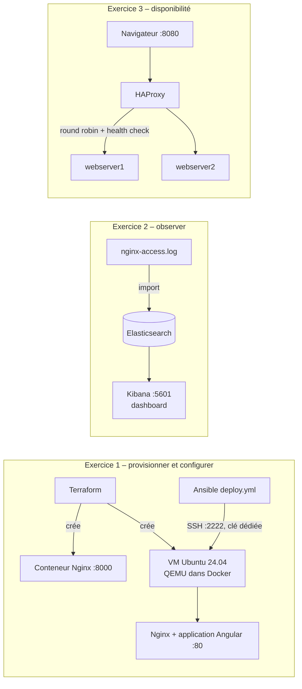
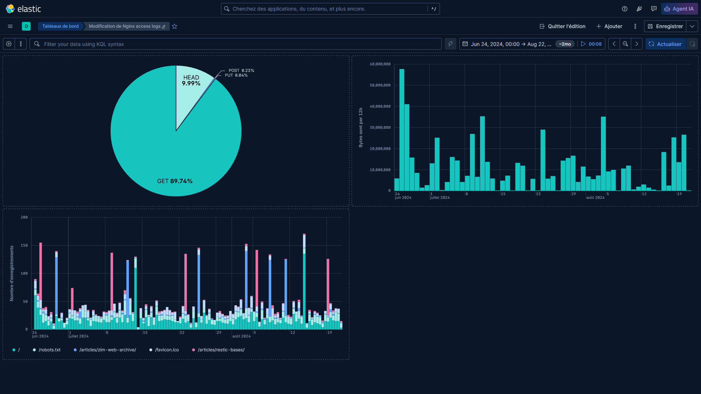
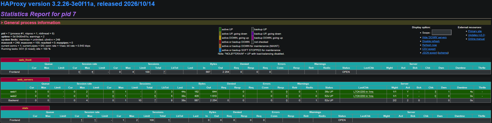

# Infrastructure as Code, supervision ELK et répartition de charge

Projet 5 du Master Expert DevOps (OpenClassrooms) : provisionner une
infrastructure avec **Terraform**, la configurer avec **Ansible**, analyser des
logs avec **Elasticsearch et Kibana**, et garantir la disponibilité d'un service
web avec **HAProxy**. Option « locale » (Docker) retenue pour les trois
exercices : même architecture que l'option AWS, sans coût et sans la limite de
mémoire du free tier (1 Go, insuffisant pour Elasticsearch).

**Statut : terminé** – les trois exercices sont réalisés, testés et documentés.

## Sommaire
- [Architecture](#architecture)
- [Stack et versions](#stack-et-versions)
- [Arborescence](#arborescence)
- [Prérequis](#prérequis)
- [Exercice 1 – Terraform et Ansible](#exercice-1--terraform-et-ansible)
- [Exercice 2 – Supervision avec Elasticsearch et Kibana](#exercice-2--supervision-avec-elasticsearch-et-kibana)
- [Exercice 3 – Répartition de charge avec HAProxy](#exercice-3--répartition-de-charge-avec-haproxy)
- [Sécurité](#sécurité)
- [Limites et évolutions](#limites-et-évolutions)
- [Méthode de travail et collaboration avec l'IA](#méthode-de-travail-et-collaboration-avec-lia)
- [Sources](#sources)

## Architecture

Les trois exercices sont indépendants ; ensemble, ils couvrent trois piliers
d'une démarche DevOps : **provisionner et configurer**, **observer**,
**garantir la disponibilité**.



Terraform et Ansible sont lancés l'un après l'autre : Terraform crée la VM
(provisionnement), Ansible installe et configure ce qui tourne dessus
(gestion de configuration).

## Stack et versions

Versions vérifiées sur [endoflife.date](https://endoflife.date) le 24/10/2026.
Le kit fourni utilisait des versions qui ne sont plus supportées : elles ont
été mises à jour.

| Outil | Version | Kit d'origine | Pourquoi |
|---|---|---|---|
| Terraform | 1.17 (`~> 1.17`) | – | Paquet officiel HashiCorp (dépôt APT signé) |
| Provider `kreuzwerker/docker` | 4.6.0 (`~> 4.6`) | 3.0.2 | Dernière version stable |
| Ansible | core 2.21.5 (PPA officiel) | – | Le paquet Ubuntu (2.20) n'est plus supporté |
| Image de la VM | `qemux/qemu:7.50` + Ubuntu 24.04 LTS | `qemux/qemu-docker:5.16` | L'image du kit n'existe plus sur Docker Hub |
| Nginx (exercice 1) | `nginx:stable-alpine` (1.30.6) | `nginx:latest` (énoncé) | Branche stable, variante Alpine : moins de failles |
| Elasticsearch / Kibana | 9.5.5, variante Wolfi | 7.14.0 | 7.14 en fin de support ; Wolfi = base minimale |
| HAProxy | 3.2 LTS, variante Alpine (support jusqu'en 2030) | 2.3 | 2.3 en fin de support |
| Serveurs web (exercice 3) | `nginxdemos/hello:0.4` + correctifs Alpine | `nginxdemos/hello` | Image reconstruite (`webserver/Dockerfile`) |

## Arborescence

```
.
├── terraform/
│   ├── nginx/            # Ex. 1 – conteneur Nginx (provider Docker)
│   └── ubuntu-vm/        # Ex. 1 – VM Ubuntu cible d'Ansible (+ cloud-init/)
├── ansible/              # Ex. 1 – inventaire, playbook, template, application
├── monitoring/elk/       # Ex. 2 – Elasticsearch + Kibana, logs d'exemple
├── load-balancing/haproxy/ # Ex. 3 – HAProxy + deux serveurs web (webserver/)
└── docs/                 # Captures (dashboard Kibana, statistiques HAProxy)
```

Un dossier par outil : chaque partie est autonome et réutilisable. Côté
Terraform, `nginx/` et `ubuntu-vm/` sont deux configurations racines
indépendantes (chacune son `init`, son état, son `apply`), découpées selon la
convention HashiCorp : `terraform.tf` (versions), `variables.tf`, `main.tf`,
`outputs.tf`.

## Prérequis

- Linux avec Docker (testé avec Docker 29) et KVM (`/dev/kvm`) pour la VM.
- Terraform 1.17, Ansible core 2.21 (`ansible --version`).
- Outils de la VM : `cloud-localds` (paquet `cloud-image-utils`) et `envsubst`.
- Pour Elasticsearch : `sysctl vm.max_map_count` ≥ 262144.

## Exercice 1 – Terraform et Ansible

### Conteneur Nginx (`terraform/nginx`)
Un provider `docker`, une ressource `docker_image` (`nginx:stable-alpine`) et une
ressource `docker_container` qui l'utilise, port 80 publié sur le port 8000.

```bash
cd terraform/nginx
terraform fmt -check && terraform init && terraform validate
terraform plan -out=nginx.tfplan   # relire le plan : 2 to add
terraform apply nginx.tfplan
terraform show && docker ps        # vérification
curl -I http://localhost:8000      # HTTP 200
terraform destroy
```

### VM cible d'Ansible (`terraform/ubuntu-vm`)
Une VM Ubuntu 24.04 démarrée par QEMU dans un conteneur. Au premier démarrage,
cloud-init crée le compte `ansible` avec une clé SSH dédiée (pas de mot de
passe).

```bash
ssh-keygen -t ed25519 -f ~/.ssh/p5_vm_ed25519      # une seule fois
cd terraform/ubuntu-vm
./cloud-init/generate.sh                           # crée cloud-init.img
terraform init && terraform plan -out=vm.tfplan && terraform apply vm.tfplan
terraform output ssh_command                       # connexion (~60 s après)
```

### Déploiement de l'application (`ansible/`)
`deploy.yml` installe Nginx, copie l'application Angular déjà compilée, déploie
la configuration du site (template `app.conf.j2`) et redémarre Nginx par un
**handler**, seulement si la configuration a changé (après `nginx -t`).

```bash
cd ansible
ansible all -i hosts -m ping                       # "ping": "pong"
ansible-playbook --syntax-check deploy.yml
ansible-lint deploy.yml                            # 0 erreur (profil production)
ansible-playbook -i hosts deploy.yml               # 2e passage : changed=0
curl -I http://127.0.0.1                           # HTTP 200
```

## Exercice 2 – Supervision avec Elasticsearch et Kibana

```bash
cd monitoring/elk
docker compose up -d && docker compose ps          # elasticsearch "healthy"
```

Kibana : http://localhost:5601. Le fichier `samples/nginx-access.log` est
importé par l'outil d'import de fichiers de Kibana (index `nginx-access`,
14 496 lignes), sur la période du 24/06 au 22/08/2024.

| Graphique | Configuration |
|---|---|
| Répartition des verbes HTTP (donut) | Top values de `http.request.method` |
| Octets envoyés par tranche de 12 h (histogramme) | Somme de `http.response.body.bytes`, intervalle 12h |
| Top 5 des requêtes par 12 h (histogramme empilé) | Nombre de requêtes, ventilé par top 5 de `url.original` |

Captures : [docs/kibana/](docs/kibana/).



Logstash n'est pas déployé : comme dans le kit, la structuration des lignes de
log est faite par l'outil d'import de Kibana.

## Exercice 3 – Répartition de charge avec HAProxy

```bash
cd load-balancing/haproxy
docker compose up -d
docker compose exec haproxy haproxy -c -f /usr/local/etc/haproxy/haproxy.cfg
for i in 1 2 3 4; do curl -s http://127.0.0.1:8080 | grep "Server name"; done
```

Configuration (`haproxy.cfg`) :
- **Répartition** : `balance roundrobin` entre `webserver1` et `webserver2`.
- **Contrôle de santé** : requête HTTP `GET /` attendue en 200, toutes les 2 s ;
  3 échecs = serveur retiré, 2 succès = serveur réintégré.
- **Bascule** : `retries 3` et `option redispatch` renvoient une requête
  échouée vers l'autre serveur.
- **Temps d'attente** : `timeout connect/client/server/http-request`.
- **Surveillance** : journaux HTTP détaillés et page de statistiques
  (http://localhost:8404/stats).

Panne testée : `docker compose stop webserver1` → `web1 is DOWN` et seul le
second serveur répond ; `docker compose start webserver1` → `web1 is UP`,
réintégré sans intervention.



Dans le Cloud, le même rôle est tenu par un répartiteur géré (AWS Application
Load Balancer avec groupe cible et contrôles de santé), supervisé par
CloudWatch.

## Sécurité

- **Accès à la VM** : clé SSH ed25519 dédiée, authentification par mot de passe
  désactivée, connexion root interdite, vérification de l'empreinte du serveur
  (`host_key_checking = True`).
- **Exposition réseau** : ports de la VM, d'Elasticsearch, de Kibana et de
  HAProxy liés à `127.0.0.1` (invisibles depuis le réseau local).
- **Nginx** : version masquée (`server_tokens off`) et en-têtes de sécurité
  (`X-Frame-Options`, `X-Content-Type-Options`, `Referrer-Policy`).
- **Moindre privilège** : le conteneur de la VM reçoit uniquement `NET_ADMIN`
  (pas `privileged`) ; le disque cloud-init et les configurations sont montés
  en lecture seule.
- **Chaîne d'approvisionnement** : empreinte de la clé de signature HashiCorp
  vérifiée avant installation ; versions des providers figées par
  `.terraform.lock.hcl` ; images épinglées.
- **Secrets et état** : `terraform.tfstate`, plans, clés et `.env` exclus de Git.
- **Données personnelles (RGPD)** : adresses IP des logs d'exemple
  pseudonymisées (dernier octet remplacé par 0) avant publication.

### Analyse de sécurité avec trivy (28/10/2026)

Scan local avec [trivy](https://trivy.dev) 0.75.0 (failles hautes et
critiques), puis réduction en trois techniques : **variante d'image plus
légère** de la même version, **reconstruction avec les correctifs** du système,
et **documentation** de ce que seul l'éditeur peut corriger.

```bash
docker run --rm -v /var/run/docker.sock:/var/run/docker.sock \
  aquasec/trivy:0.75.0 image --scanners vuln --severity HIGH,CRITICAL <image>
docker run --rm -v "$PWD:/src:ro" aquasec/trivy:0.75.0 config /src
docker run --rm -i hadolint/hadolint:v2.14.0 < load-balancing/haproxy/webserver/Dockerfile
```

| Exercice | Avant (critiques / hautes) | Après | Ce qui reste |
|---|---|---|---|
| 1 – Nginx | `nginx:latest` : 1 / 58 | `nginx:stable-alpine` : **0 / 3** | 3 failles de curl, sans correctif publié |
| 2 – Elasticsearch | 9.5.5 : 1 / 37 | 9.5.5 Wolfi : **0 / 30** | Bibliothèques Java intégrées par Elastic (guava, jackson) |
| 2 – Kibana | 9.5.5 : 5 / 70 | 9.5.5 Wolfi : **4 / 50** | Dépendances JavaScript de Kibana (axios, undici…) |
| 3 – HAProxy | `haproxy:3.2` : 0 / 43 | `haproxy:3.2-alpine` : **0 / 0** | – |
| 3 – Serveurs web | `nginxdemos/hello` : 3 / 61 | image reconstruite : **0 / 0** | – |
| 1 – VM (outil de test) | `qemux/qemu:7.50` : 15 / 270 | inchangée | Voir ci-dessous |

- **Failles critiques : de 25 à 4.** Les 4 restantes sont dans le code de
  Kibana : seule une nouvelle version d'Elastic peut les corriger (9.5.5 est la
  dernière, vérifié le 28/10).
- **VM `qemux/qemu`** non modifiée : c'est un outil local qui simule le serveur
  cible, pas un service déployé ; une reconstruction ne corrigerait qu'environ
  un tiers des failles (Debian n'a pas publié le reste) avec un risque de casser
  la VM.
- **Configuration Terraform** (`trivy config`) : 0 erreur. Les règles visent
  surtout les fournisseurs Cloud : peu s'appliquent au provider Docker.
- Risque résiduel accepté pour cet environnement local (services sur
  127.0.0.1, données fictives). En production : scan bloquant dans la CI sur
  les failles critiques corrigeables (`--ignore-unfixed --exit-code 1`),
  reconstruction régulière des images, et dans le Cloud un scan géré
  (Amazon ECR, Amazon Inspector).

## Limites et évolutions

Limites assumées pour un environnement d'exercice local :
- Sécurité d'Elasticsearch désactivée (`xpack.security.enabled=false`),
  compensée par l'écoute sur 127.0.0.1 ; en production : authentification et
  TLS activés, mots de passe hors du dépôt.
- Écart assumé avec l'énoncé : `nginx:stable-alpine` au lieu de `nginx:latest`
  (branche stable, moins de failles) ; en production on épinglerait aussi
  l'empreinte (`nginx@sha256:…`).
- `sudo` sans mot de passe pour le compte `ansible` de la VM (nécessaire à une
  exécution sans saisie).
- État Terraform local ; application compilée versionnée dans Git.

Évolutions possibles :
- Backend distant avec verrou pour l'état Terraform (travail en équipe).
- Modules Terraform et rôles Ansible pour réutiliser le code.
- Enchaîner Terraform et Ansible dans une CI (GitHub Actions), avec
  `terraform fmt/validate`, `ansible-lint` et un scan des images (trivy).
- Application construite par la CI et téléchargée par Ansible.
- Anonymisation des adresses IP à l'ingestion (pipeline Elasticsearch).
- OpenTofu, alternative libre à Terraform (licence BUSL depuis 2023).

## Méthode de travail et collaboration avec l'IA

Les fichiers de ce dépôt ont été rédigés avec l'aide d'une IA, en mode guidé :
je les ai saisis, exécutés, testés et compris étape par étape. Les
vérifications, ainsi que les choix de versions et de sécurité, ont été validés
par moi.

## Sources

Starter kit OpenClassrooms « DevOps-4091 » (application Angular, fichier de
logs d'exemple, configurations de départ), documentations officielles de
Terraform, Ansible, Elastic et HAProxy.
